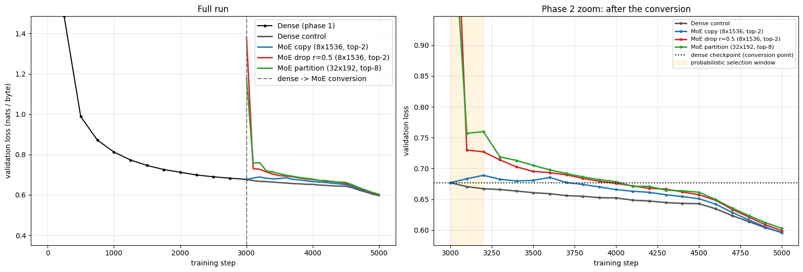
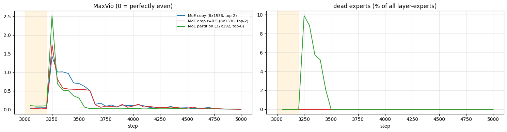
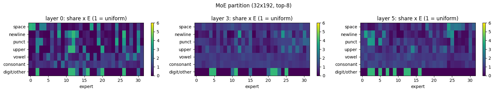

# Session 14 Assignment: Dense → Mixture-of-Experts Upcycling

> **Assignment:** Train a Linear model and convert that into an MoE. Your call on model size and data, but you must show the models continue to train and reduce loss.

I trained a small dense GPT, whose feed-forward blocks are plain linear layers, on TinyStories. Then I converted every feed-forward block into a Mixture-of-Experts layer in three different ways and kept training. As a control, a copy of the dense model kept training on the same data. **All three MoE models continued to train and finished well below the dense checkpoint they were grown from.**



## Results

The run used a Tesla T4 on Colab: 3,000 dense steps followed by 2,000 continuation steps. Validation loss is in nats per byte, measured on the same fixed validation batches for every model.

| model | total params | active params | val loss right after conversion | final val loss | change vs dense checkpoint |
|---|---|---|---|---|---|
| Dense checkpoint (end of phase 1) | 14.36M | 14.36M | – | 0.6769 | – |
| Dense control (keeps training) | 14.36M | 14.36M | 0.6769 | 0.5961 | −0.0807 |
| **MoE copy** (8 × 1536, top-2) | 88.69M | 24.99M | **0.6769** | **0.5955** | −0.0813 |
| **MoE drop** r = 0.5 (8 × 1536, top-2) | 88.69M | 24.99M | 1.3832 | 0.5989 | −0.0780 |
| **MoE partition** (32 × 192, top-8) | 46.28M | 14.43M | 1.1777 | 0.6027 | −0.0741 |

**Key observations**

1. **Every MoE kept training and reduced its loss.** All three ended below the dense checkpoint, and no expert in any layer was unused at the end.
2. **Copy-upcycling preserves the model's function exactly.** Its loss right after conversion (0.6769) equals the dense model's. Every expert is a copy of the dense FFN and the router weights sum to 1, so the output is unchanged.
3. **Drop and partition start worse and recover fast.** They jumped to 1.38 and 1.18, were back to about 0.73–0.76 within 100 steps, and kept falling.
4. **Switching from probabilistic to hard top-k caused a brief imbalance spike.** MaxVio rose to about 2.5, and about 10 % of the partition model's experts went briefly unused. Bias balancing brought unused experts back to 0 within about 300 steps and MaxVio down to 0.02 or less by the end. During the 200-step probabilistic window, the copy model's loss rose slightly (0.6769 → 0.6888) before falling steadily.
5. **At this budget the MoE did not beat the dense control.** Copy tied it; drop and partition finished 0.003 and 0.007 behind. Copy and drop use about 2× the dense FFN compute per token. Partition is the compute-matched variant: 8 × 192 = 1,536 active width, the same as the dense FFN.
6. **Experts specialize by kind of token, not by topic.** In the first and last layers, individual experts receive spaces, newlines, punctuation or digits at 3–4× their even share. Middle layers are the least specialized.




## Method

**Data.** TinyStories, byte-level with a vocabulary of 256: 100M training bytes and 2M validation bytes.

**Dense model (phase 1).** A 6-layer GPT with d_model 384, 6 heads, RMSNorm, a SwiGLU FFN of hidden width 1,536, context length 256, and tied embeddings, 14.36M parameters in total. It trained for 3,000 steps at batch size 64 and learning rate 1e-3, with warmup followed by a constant rate. With no decay, the checkpoint is still learning.

**Conversion.** In every layer, the FFN is replaced by a router plus experts initialised from the trained FFN. Attention, embeddings and norms are copied unchanged.

| method | experts | how each expert starts |
|---|---|---|
| copy (sparse upcycling) | 8 × 1536, top-2 | exact copy of the dense FFN |
| drop (drop-upcycling, r = 0.5) | 8 × 1536, top-2 | copy with a different random half of its neurons redrawn from N(mean, std) of the original weights |
| partition (fine-grained, Qwen1.5-MoE style) | 32 × 192, top-8, routed scale 8 | 4 shuffled copies of the 1,536 neurons cut into 192-wide slices |

**MoE layer, following the lesson's recipe**

- The router runs in fp32 with small initialisation. It applies softmax, keeps the top-k, and renormalises those k weights to sum to 1.
- **Auxiliary-loss-free balancing:** each expert has a bias that is used only when choosing experts, updated with `b += 1e-3 · sign(mean_load − load)`. On top of that there is a tiny auxiliary loss (1e-4) and a router z-loss (1e-3).
- Load is counted over the whole batch, not per sequence.
- Routing is dropless: every token is processed by all k of its experts.
- For the first 200 steps after conversion, experts are selected probabilistically (Gumbel top-k), so cloned experts all get gradient before the router settles.

**Continuation (phase 2).** Four models trained for 2,000 steps each: the dense control and the three MoE variants. All four used the same data order, a fresh AdamW optimizer, 50 warmup steps, a constant learning rate of 1e-3, and linear decay over the last 25 %.

## Repository contents

```
.
├── README.md
├── S14_dense_to_MoE_upcycling.ipynb     # full notebook, executed, with all outputs
└── results/
    ├── 01_validation_loss_curves.png        # full run + zoom on phase 2
    ├── 02_phase2_train_loss.png
    ├── 03_load_balance_maxvio_dead_experts.png
    ├── 04_expert_load_heatmap.png           # per-layer load / even share at the end
    ├── 05_specialization_copy.png           # byte class × expert, layers 0 / 3 / 5
    ├── 06_specialization_drop.png
    ├── 07_specialization_partition.png
    ├── training_log.csv                     # every validation checkpoint: loss, MaxVio, dead experts
    ├── summary.json                         # config + final numbers
    ├── results_table.txt                    # printed tables and checks
    ├── expert_specialization.txt
    └── samples.txt                          # generated text from each model
```

## Reproduce

1. Open the notebook in Google Colab and select a GPU runtime (Runtime → Change runtime type).
2. Run all cells. With `QUICK = False`, the full run takes about 55 minutes on a T4. With `QUICK = True`, a smoke test takes about 3 minutes.

The only dependency not installed on Colab by default is `datasets`, and it is usually present already.

## Next experiments

- Run the copy model with no probabilistic-selection window (`explore_steps=0`) to remove its early loss bump.
- Continue training longer, for example 6,000 steps, to see whether the MoE pulls ahead of the dense control.
- Turn balancing off (`bias_gamma=0, aux_coef=0`) and watch the routing collapse.
- Vary `drop_ratio` over {0.25, 0.75}, and try more experts at the same top-k.

## References

- Session 14 lesson, *Mixture-of-Experts*, The School of AI, ERA V5
- Komatsuzaki et al., *Sparse Upcycling*, 2022
- Nakamura et al., *Drop-Upcycling*, 2025
- Wang et al., *Auxiliary-Loss-Free Load Balancing*, 2024
- Fedus et al., *Switch Transformer*, 2021
- Zoph et al., *ST-MoE*, 2022
